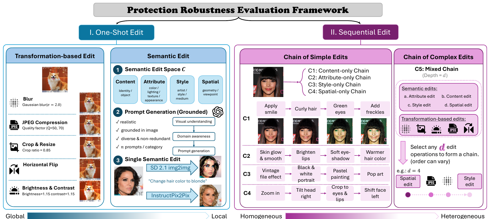

# PREEMPT: Proactive Robustness Evaluation under Editing for Media Protection Techniques

**Accepted by WACV 2027.** &nbsp;[Paper](https://arxiv.org/abs/2610.24205) · [Project page](#)

**PREEMPT** evaluates how long proactive image protections — adversarial perturbations and invisible
watermarks — stay effective when a protected image is edited once or many times in a row.



## What PREEMPT evaluates

| Setting | Edits | Depth |
|---|---|---|
| One-shot, image transformation | Gaussian blur (σ = 2), JPEG (Q = 50, 70), crop-and-resize (0.85), horizontal flip, brightness/contrast (×1.15) | 1 |
| One-shot, semantic edit | Content, Attribute, Style, Spatial (4 prompts each), run by InstructPix2Pix or Stable Diffusion 2.1 img2img | 1 |
| Sequential, simple chains C1–C4 | Semantic edits from one category: content-only, attribute-only, style-only, spatial-only | D (4 in the paper) |
| Sequential, mixed chains CX1–CX4 | Semantic edits and image transformations sampled together | D (4 in the paper) |

Protection effectiveness S(d) after d edits is measured with the metric of each protection paradigm:

| Paradigm | S(d) |
|---|---|
| Perturbation, faces | ArcFace identity similarity to the clean image |
| Perturbation, artworks | CSD style similarity to the clean image |
| Perturbation, objects | DINOv2 feature similarity to the clean image |
| Watermark | Bit accuracy of the decoded message |

## Metrics

**Protection Survival Ratio (PSR).** S(0) is the metric of the protected, unedited image.

$$\tilde S(d) = \frac{S(d)}{S(0)}$$

**Protection survival curve.** The PSR over editing depth, $\{\tilde S(0), \tilde S(1), \dots, \tilde S(D)\}$, with $\tilde S(0) = 1$.

**Protection AUC (PAUC).** The normalized area under the survival curve, in $[0, 1]$; higher is more robust.

$$\mathrm{PAUC} = \frac{1}{D}\sum_{d=0}^{D-1}\frac{\tilde S(d) + \tilde S(d+1)}{2}$$

All three are computed in [`utils/survival.py`](utils/survival.py) (`per_image_psr`, `survival_curve`,
`protection_auc`) and written to tables by [`scripts/compute_survival.py`](scripts/compute_survival.py).

## Installation

```bash
git clone <this repository> && cd PREEMPT
conda env create -f environment.yml
conda activate preempt
```

Editing models and metric backbones are downloaded from Hugging Face on first use
(set `HF_HOME` to choose the cache folder).

## Prepare your images

PREEMPT does not ship images. Put the clean images and the protected images of each method under one
root folder, using the same file name for the same image:

```
$PREEMPT_DATA_ROOT/
  Protection/
    Clean/                 # unprotected images, reported as "None"
      faces/  arts/  objects/
    <YourMethod>/          # one folder per protection method
      faces/  arts/  objects/
```

Edited images are written to `$PREEMPT_DATA_ROOT/Eval/`.

## Generate editing prompts

Semantic edits read their prompts from [`config/editing_prompts.json`](config/editing_prompts.json).
The prompts are generated by GPT-4.1 mini: for each image, the model reads the image and the
instruction in [`config/vlm_prompt.txt`](config/vlm_prompt.txt) and returns four prompts per category.

```bash
pip install openai
export OPENAI_API_KEY=...
bash run_preempt.sh prompts        # reads $PREEMPT_DATA_ROOT/Protection/Clean/<domain>/
```

Images already in the file are skipped, so new images are added without changing existing prompts.
The script lists any image whose reply has an empty category or is not valid JSON; edit those
entries by hand or re-run with `--overwrite`. The file is keyed by image file name:

```json
"my_image.png": {
  "domain": "CelebA-HQ",
  "prompts": {
    "Content":   ["...", "...", "...", "..."],
    "Attribute": ["...", "...", "...", "..."],
    "Style":     ["...", "...", "...", "..."],
    "Spatial":   ["...", "...", "...", "..."]
  }
}
```

## Run

```bash
export PREEMPT_DATA_ROOT=/path/to/your/images
export EDITOR_NAME=ip2p        # or sd21
```

| Step | Command | Output |
|---|---|---|
| 0. Editing prompts (optional, see above) | `bash run_preempt.sh prompts` | `config/editing_prompts.json` |
| 1. Index images | `bash run_preempt.sh metadata` | `records/all_metadata.csv` |
| 2. One-shot transformations | `bash run_preempt.sh one-shot-transformation` | `records/one_shot_transformation_records.csv` |
| 3. One-shot semantic edits | `bash run_preempt.sh one-shot-semantic` | `records/one_shot_semantic_records.csv` |
| 4. Simple chains C1–C4 | `bash run_preempt.sh sequential-simple` | `records/sequential_simple_records.csv` |
| 5. Mixed chains CX1–CX4 | `bash run_preempt.sh sequential-complex-generate`<br>`bash run_preempt.sh sequential-complex` | `records/sequential_complex_records.csv` |
| 6. Metrics of steps 2–4 | `bash run_preempt.sh metrics` | `records/metrics/level{1,2,3}_metrics.csv` |
| 7. S(0) of protected images | `bash run_preempt.sh depth0` | `records/metrics/level3_depth0_metrics.csv` |
| 8. Metrics of mixed chains | `bash run_preempt.sh sequential-complex-metrics` | `records/metrics/sequential_complex_metrics.csv` |
| 9. PSR, survival curves, PAUC | `bash run_preempt.sh psr` | `records/survival/` |

`bash run_preempt.sh all` runs steps 1–9 in order. Step 9 writes `initial_effectiveness.csv` (S(0) per method), `survival_curves.csv` (PSR per method,
chain type and depth) and `pauc.csv` (PAUC per method and chain type).

## Evaluating a watermark

PREEMPT does not include watermarking methods. Wrap your method's own decoder in a class with a
`decode` method:

```python
# my_watermark.py
class MyDecoder:
    def __init__(self):
        self.model = ...                      # load your decoder

    def decode(self, image):                  # PIL.Image -> bit string, e.g. "0110..."
        return self.model.decode(image)
```

Embed the watermark into the clean images yourself, place them under `Protection/<YourMethod>/`,
run steps 1–8, then score the edited images and compute the survival tables:

```bash
export PYTHONPATH=$PWD
python scripts/score_watermark.py --decoder my_watermark:MyDecoder --protection MyWatermark \
    --reference-bits 0101... --records records/sequential_simple_records.csv \
    --out records/metrics/watermark_simple.csv --with-depth0
python scripts/score_watermark.py --decoder my_watermark:MyDecoder --protection MyWatermark \
    --reference-bits 0101... --records records/sequential_complex_records.csv \
    --out records/metrics/watermark_complex.csv --with-depth0
python scripts/compute_survival.py \
    --watermark-homo records/metrics/watermark_simple.csv \
    --watermark-hetero records/metrics/watermark_complex.csv \
    --watermark-depth0 records/metrics/watermark_simple.csv
```

Use `--reference-text` instead of `--reference-bits` for text payloads.

## Third-party components

PREEMPT calls the following models through their public releases; please follow their licenses.

| Component | Used for | Source |
|---|---|---|
| GPT-4.1 mini | Editing prompt generation | [OpenAI API](https://platform.openai.com/docs/models/gpt-4.1-mini) |
| InstructPix2Pix | Semantic editing | `timbrooks/instruct-pix2pix` |
| Stable Diffusion 2.1 | Semantic editing (img2img) | `sd2-community/stable-diffusion-2-1` |
| InsightFace `buffalo_l` (ArcFace) | Face identity similarity | [insightface](https://github.com/deepinsight/insightface) |
| CSD ViT-L | Style similarity | `tomg-group-umd/CSD-ViT-L` |
| DINOv2 ViT-B/14 | Object similarity | `facebook/dinov2-base` |
| CLIP ViT-B/32, LPIPS | Image-quality metrics | [open_clip](https://github.com/mlfoundations/open_clip), [lpips](https://github.com/richzhang/PerceptualSimilarity) |

## Citation

```bibtex
@inproceedings{preempt2027,
  title     = {PREEMPT: Proactive Robustness Evaluation under Editing for Media Protection Techniques},
  author    = {Tang, Qiuyu and Bharati, Aparna},
  booktitle = {Proceedings of the IEEE/CVF Winter Conference on Applications of Computer Vision (WACV)},
  year      = {2027}
}
```

## License

Released under the [MIT License](LICENSE).
